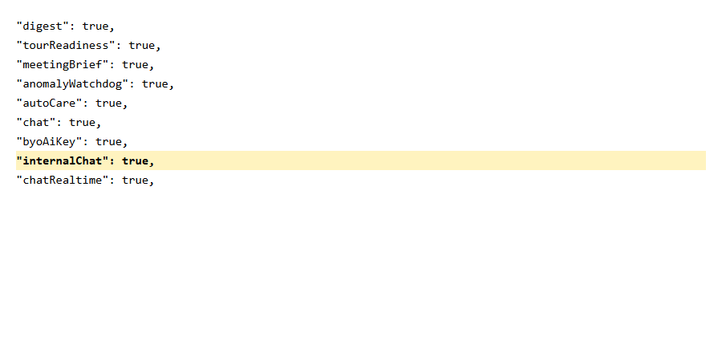
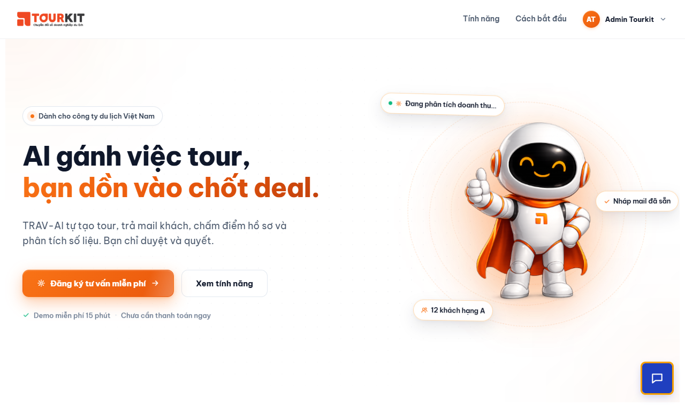
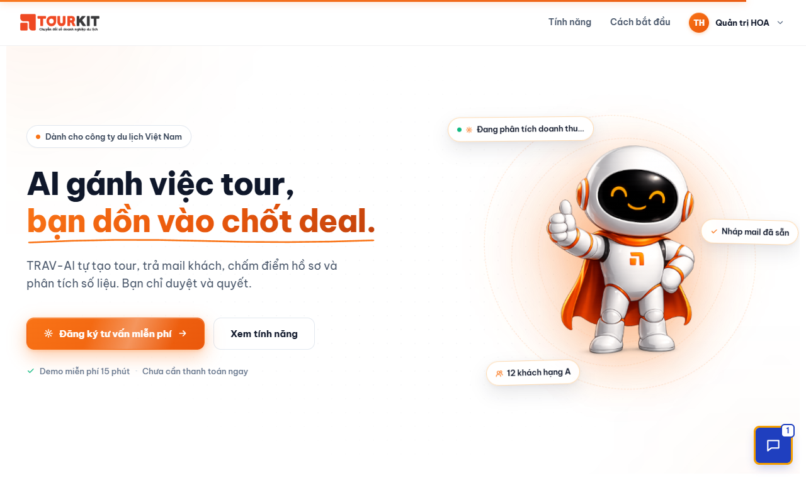
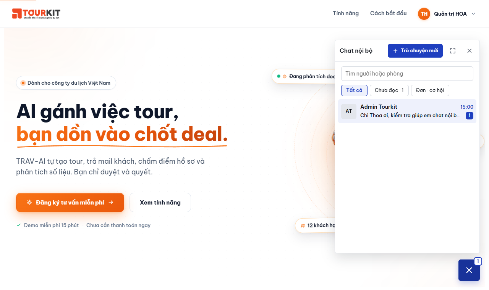
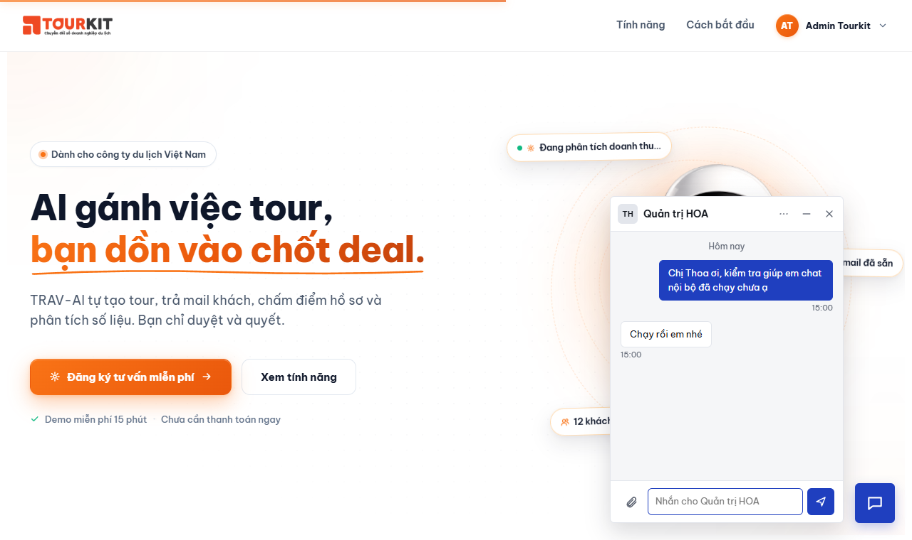
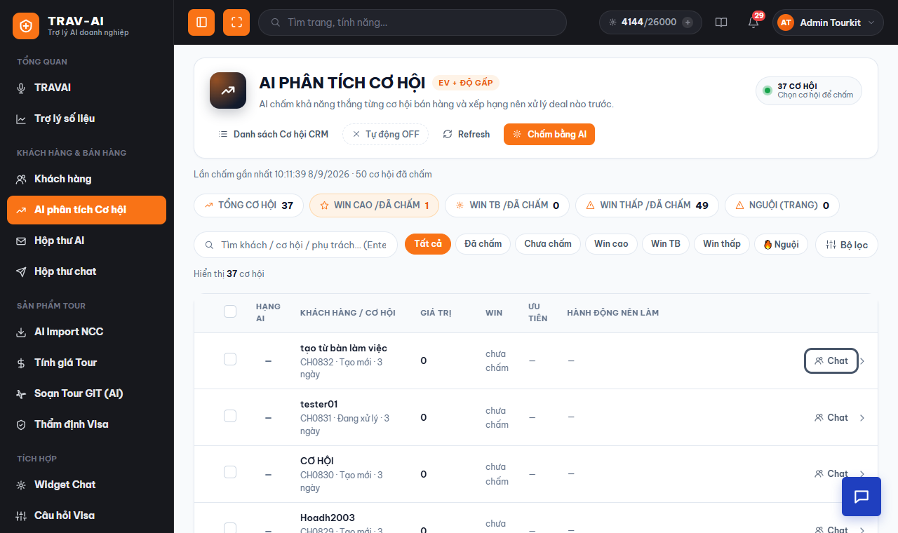
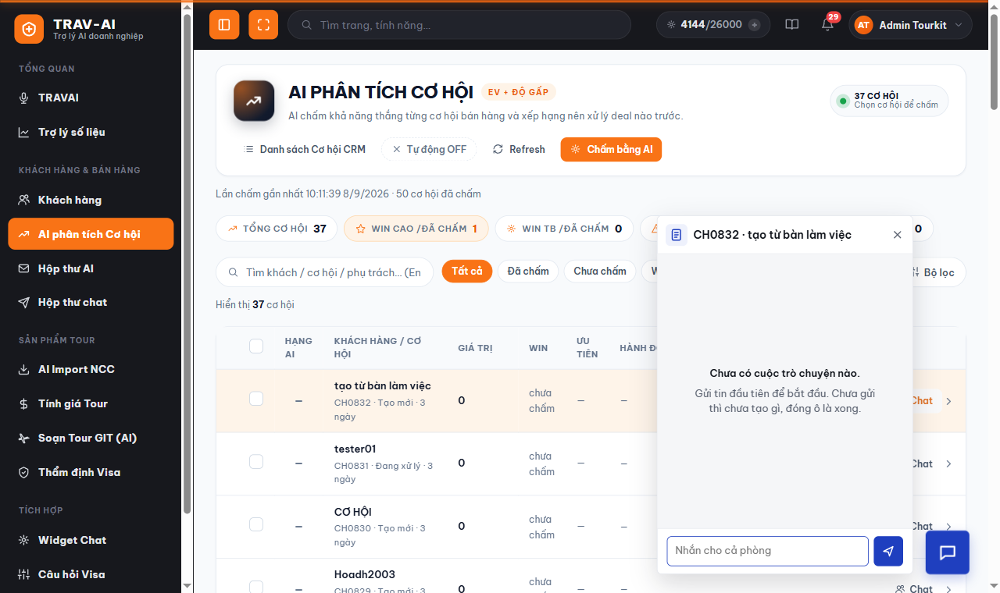
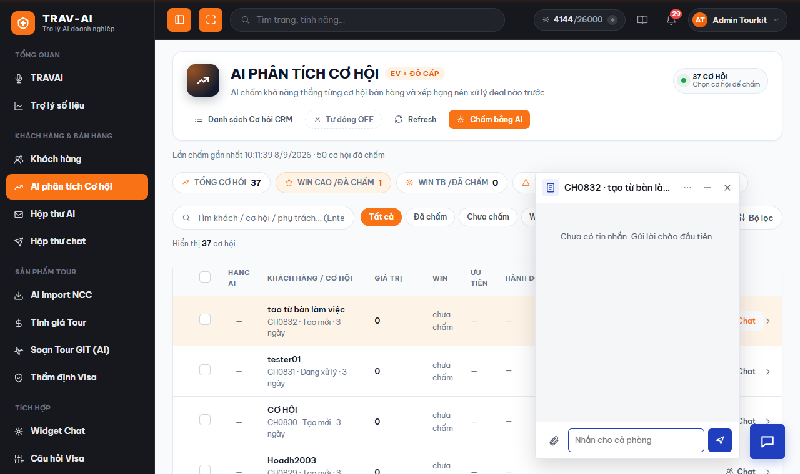
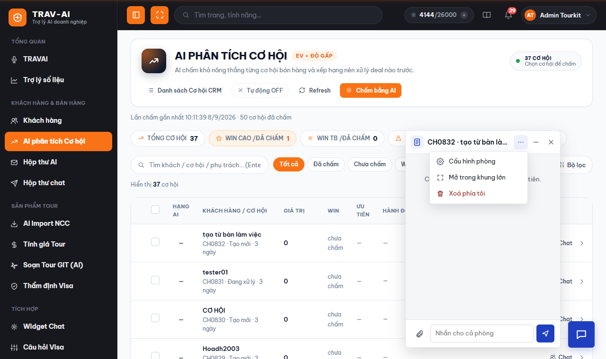
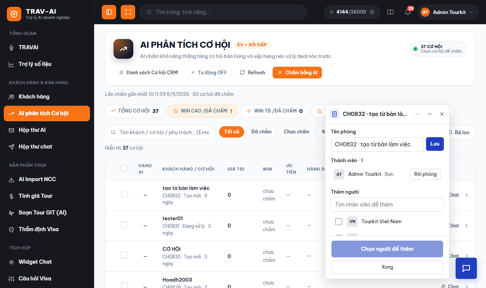

# Triển khai Chat nội bộ lên máy chủ thật

Hướng dẫn cho lần phát hành 19/10/2026: chat nội bộ giữa nhân viên (widget nút chat góc phải, nút
**Chat** trên màn Cơ hội, phòng khoá tự đặt, dòng thông báo trong phòng) cùng các bản sửa lỗi nhỏ.

| | |
|---|---|
| Mã cần deploy | nhánh `main` trên `origin`, commit `41f9e67` trở về sau |
| CSDL | **Không phải chạy migration.** CSDL chat (`tourkit-chat` trên 103.154.63.14) đã có đủ cột và chỉ mục, kiểm tra lần cuối 19/10/2026 |
| Cấu hình phải thêm | `Features:InternalChat = true` trong `appsettings.json` của site người dùng |
| Thời gian dự kiến | 15–20 phút, site gián đoạn khoảng 1 phút mỗi lần chép tệp |

Deploy đang làm **bằng tay** theo đúng các bước của
[.github/workflows/deploy-web.yml](../.github/workflows/deploy-web.yml) (workflow tạm tắt vì máy chủ
chưa có runner). Một bản build chép ra **hai site IIS**:

| Site | Thư mục | Địa chỉ | Vai trò |
|---|---|---|---|
| Người dùng | `C:\inetpub\wwwroot\Tour_AI` | https://tourkit-ai.tourkit.vn | Giao diện + API, **chat nội bộ chạy ở đây** |
| Workflow | `C:\inetpub\wwwroot\Tour_AI_Workflows` | https://workflows.travelai.vn | Chạy tác vụ nền theo lịch |

---

## 1. Chuẩn bị trên máy dev

```powershell
cd D:\MiGroup\tourkitapp\tourkit-ai-proxy
git checkout main
git pull origin main
git log --oneline -1          # phải là 41f9e67 hoặc mới hơn

# Chạy toàn bộ test, KHÔNG lọc (guard kiến trúc nằm rải trong đó). Phải xanh mới đi tiếp.
dotnet test TourkitAiProxy.Tests/TourkitAiProxy.Tests.csproj

# Build Release: MSBuild tự đóng gói giao diện (wwwroot/dist/app.bundle.js) bằng esbuild,
# máy cần có Node.js. Giống hệt lệnh của workflow.
dotnet publish TourkitAiProxy.csproj -c Release -o publish
```

Kiểm tra nhanh thư mục `publish\` có `TourkitAiProxy.dll`, `wwwroot\internal-chat.js` và
`wwwroot\dist\app.bundle.js`. Nén cả thư mục rồi chép lên máy chủ (vd `D:\deploy\publish`).

> Đừng dùng `scripts\publish.ps1` không tham số: mặc định của nó là `linux-x64`, không chạy trên IIS.

## 2. Sao lưu trước khi chép

Trên máy chủ IIS (PowerShell quyền Administrator):

```powershell
$stamp = Get-Date -Format 'yyyyMMdd-HHmm'
Copy-Item 'C:\inetpub\wwwroot\Tour_AI'           "D:\backup\Tour_AI-$stamp"           -Recurse
Copy-Item 'C:\inetpub\wwwroot\Tour_AI_Workflows' "D:\backup\Tour_AI_Workflows-$stamp" -Recurse
```

CSDL chat không đổi cấu trúc trong lần này, nhưng vẫn nên giữ một bản (chạy trên máy dev):

```powershell
.\scripts\server-manage.ps1 -Action backup -Tag "pre-deploy-chat-noi-bo"
```

## 3. Chép bản mới ra hai site

Chạy trên máy chủ, từ thư mục chứa bản build. Khối lệnh này lặp lại đúng bước deploy của workflow:
treo trang bảo trì, chép đè, gỡ trang bảo trì.

```powershell
$ErrorActionPreference = 'Stop'
$publish = 'D:\deploy\publish'                       # thư mục bản build vừa chép lên
$offline = 'D:\deploy\app_offline.htm'               # lấy từ .github\deploy\app_offline.htm trong repo

foreach ($site in 'C:\inetpub\wwwroot\Tour_AI', 'C:\inetpub\wwwroot\Tour_AI_Workflows') {
    Write-Host "==== $site"
    Copy-Item $offline (Join-Path $site 'app_offline.htm') -Force   # IIS nhả khoá tệp, hiện trang bảo trì
    Start-Sleep -Seconds 3
    robocopy $publish $site /MIR /NFL /NDL /NP /R:3 /W:5 /XF appsettings.json app_offline.htm /XD logs data
    if ($LASTEXITCODE -ge 8) { throw "robocopy lỗi ($site): exit=$LASTEXITCODE" }
    Remove-Item (Join-Path $site 'app_offline.htm') -Force          # app tự khởi động lại
}
```

**Tuyệt đối giữ nguyên `/XF appsettings.json` và `/XD logs data`.** `/MIR` xoá ở đích mọi thứ không có
trong bản build. Thiếu hai tham số này là mất khoá API, mất phiên đăng nhập, mất ảnh hồ sơ visa và ảnh
nhân viên đã gửi trong chat (`data\chat-uploads`, khi kho tệp để `local`).

## 4. Bật cờ chat nội bộ

Mở `C:\inetpub\wwwroot\Tour_AI\appsettings.json`, thêm **một dòng** vào mục `Features`, cạnh
`"Chat": true`:

```json
"Features": {
  "Chat": true,
  "InternalChat": true,
  ...
}
```

Lưu tệp rồi **bắt buộc khởi động lại** site: IIS Manager → Application Pools → chọn pool của site
Tour_AI → **Recycle**.

> Vì sao bắt buộc: các đường `/api/v1/chat/internal/*` chỉ được gắn lúc app khởi động, còn
> `/api/v1/features` đọc cờ ở mỗi lần gọi. Sửa tệp mà không Recycle thì `/features` đã báo `true`, nút chat
> hiện ra, nhưng mở chat lại nhận lỗi "Tính năng chat nội bộ đang tắt".

Site Workflow **không cần** cờ này (không ai mở giao diện ở đó). Thêm vào cũng không hại gì.

Cờ chỉ chạy được khi `appsettings.json` đã có sẵn hai mục dưới đây. Hộp thư chat đang chạy trên site thì
cả hai đã có, không phải sửa:

| Mục | Dùng cho | Thiếu thì |
|---|---|---|
| `ConnectionStrings:Chat` | CSDL chat (phòng, tin, thành viên) | mọi đường chat nội bộ trả 503 "Chat nội bộ chưa được cấu hình" |
| `Storage` (R2) | ảnh/tệp gửi kèm tin | gửi chữ vẫn được, đính kèm báo 503 |

## 5. Kiểm tra sau khi deploy

Làm lần lượt, khoảng 3 phút. Ảnh dưới chụp trên môi trường staging.

**5.1. Cờ đã bật.** Mở https://tourkit-ai.tourkit.vn/api/v1/features, phải thấy `"internalChat": true`.



`/healthz` của cả hai site cũng phải trả `"ok": true`.

**5.2. Có nút chat.** Đăng nhập TRAV-AI, nút chat xanh hiện ở góc phải dưới ngay cả khi chưa mở cuộc
trò chuyện nào.



**5.3. Nhắn 1-1 tới nơi.** Dùng hai tài khoản trên hai trình duyệt (hoặc một cửa sổ ẩn danh). Người A mở
nút chat, chọn **Trò chuyện mới**, nhắn cho người B. Bên người B, số tin mới hiện ngay trên nút mà không
cần tải lại trang:



Người B bấm nút, thấy cuộc trò chuyện trong danh sách:



Người B trả lời, người A thấy tin ngay trong ô chat nhỏ:



**5.4. Nút Chat trên màn Cơ hội.** Vào **AI phân tích Cơ hội**, mỗi dòng có nút **Chat**:



Bấm là mở **ô nháp** của đúng cơ hội đó (tên = mã cơ hội và tên khách). Lúc này **chưa có gì được tạo**:
đóng ô là xong, không để lại cuộc trò chuyện trống.



Gửi tin đầu tiên thì phòng mới được tạo (người phụ trách được thêm vào lúc này). Bấm **Chat** lại lần nữa
phải mở thẳng **cùng** phòng, không sinh phòng mới:



**5.5. Menu ⋯ và cấu hình phòng.** Bấm **⋯** trên đầu ô chat:



Chọn **Cấu hình phòng**: đổi tên, thêm người, rời phòng. Mỗi thay đổi để lại một dòng xám trong phòng
(vd "Admin Tourkit đã thêm … vào phòng"):



Xong 5.1 → 5.5 là triển khai đạt. Xoá các phòng thử bằng **⋯ → Xoá phía tôi** (chỉ ẩn với riêng bạn).

## 6. Gặp lỗi thì xem đâu

| Triệu chứng | Nguyên nhân thường gặp | Cách xử lý |
|---|---|---|
| Không có nút chat, không có nút **Chat** ở màn Cơ hội | Cờ chưa ăn | Xem lại bước 4; `/api/v1/features` phải có `internalChat: true`; Recycle app pool |
| Có nút chat, mở ra báo "Tính năng chat nội bộ đang tắt" | Đã sửa cờ nhưng chưa khởi động lại site | Recycle app pool của site Tour_AI (bước 4) |
| Có nút chat, mở ra báo "Chat nội bộ chưa được cấu hình" | Thiếu `ConnectionStrings:Chat` | Chép mục này từ cấu hình Hộp thư chat |
| Tin tới chậm khoảng 20 giây thay vì ngay | Kết nối tức thời bị chặn (proxy cắt kết nối giữ lâu) hoặc chạy nhiều tiến trình không có Redis | Widget tự hỏi lại mỗi 20 giây nên vẫn dùng được; kiểm tra `chatRealtime` trong `/api/v1/features` và `Redis:ConnectionString` |
| Gửi ảnh/tệp báo lỗi 503 | Kho tệp chưa cấu hình | Kiểm tra mục `Storage` (R2) như Hộp thư chat |
| Bấm **Chat** trên cơ hội báo "Bạn không có quyền xem cơ hội này" | Đúng thiết kế: người không có quyền xem cơ hội đó trên CRM | Cấp quyền `CH_XEM` / `CH_XEM_ALL` bên CRM nếu cần |
| Bấm **Chat** trên cơ hội báo "Chưa kiểm được quyền xem cơ hội với CRM" (503) | Không gọi được TourKit.Api lúc kiểm quyền | Kiểm tra TourKit.Api; người có `CH_XEM_ALL` không bị ảnh hưởng |
| Site trắng / lỗi 500.30 sau khi chép | App không khởi động | Xem `logs\` trong thư mục site; thường do `appsettings.json` sai cú pháp JSON sau khi sửa ở bước 4 |

## 7. Quay lui

- **Chỉ tắt tính năng** (nhanh nhất, không mất gì): đổi `"InternalChat": false` rồi Recycle app pool. Nút chat
  và nút **Chat** trên cơ hội biến mất; dữ liệu chat vẫn còn nguyên trong CSDL, bật lại là thấy lại.
- **Quay về bản cũ**: chép ngược thư mục sao lưu ở bước 2 về hai site (cùng lệnh robocopy ở bước 3, đổi
  nguồn thành thư mục sao lưu). Không phải đụng CSDL: các cột chat nội bộ không ảnh hưởng gì tới bản cũ.
- **Khôi phục CSDL chat**: chỉ khi thật sự hỏng dữ liệu, dùng bản sao lưu ở bước 2:
  `.\scripts\server-manage.ps1 -Action restore`.

## 8. Sau khi triển khai

- Báo người dùng: nội dung mới nằm ở [CHANGELOG.md](../CHANGELOG.md) mục "Phiên bản 19/10/2026".
- Muốn nhúng chat nội bộ vào trang khác (CRM web, nút Chat trên đơn hàng): xem
  [tich-hop-chat-noi-bo.md](tich-hop-chat-noi-bo.md).
- Ghi chú kỹ thuật: [docs/features/chat-inbox-ky-thuat.md § Chat nội bộ](features/chat-inbox-ky-thuat.md).

**Chưa kiểm thử trước khi phát hành:** người chỉ có quyền `CH_XEM` (không có `CH_XEM_ALL`) vào phòng cơ hội
mình phụ trách. Staging chưa có tài khoản như vậy; sau deploy nên nhờ một nhân viên bán hàng thử bấm
**Chat** trên cơ hội của chính họ.
